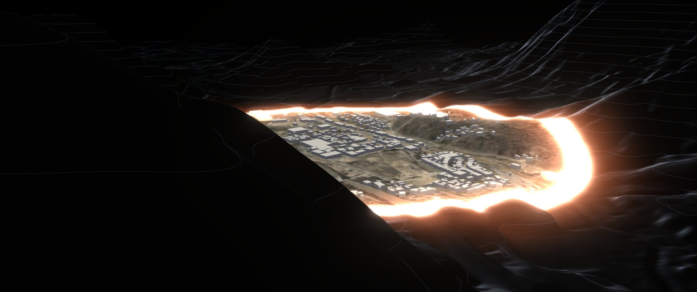
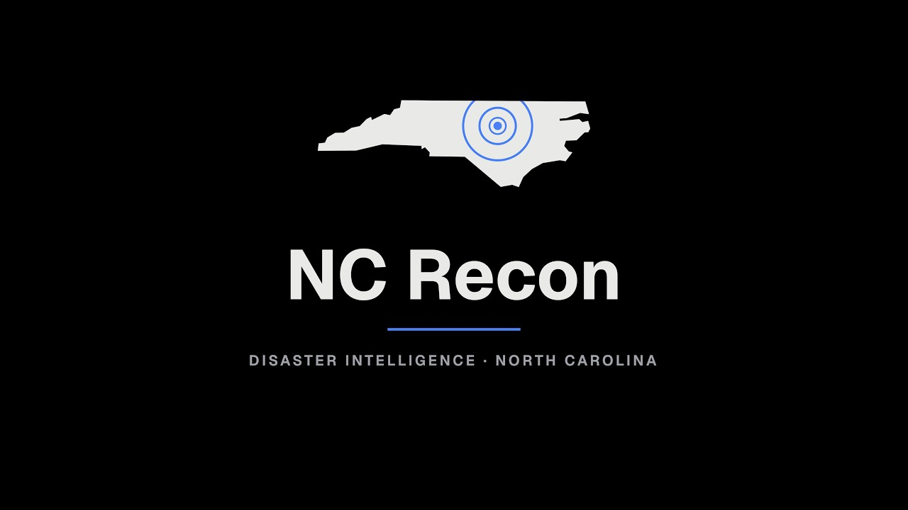
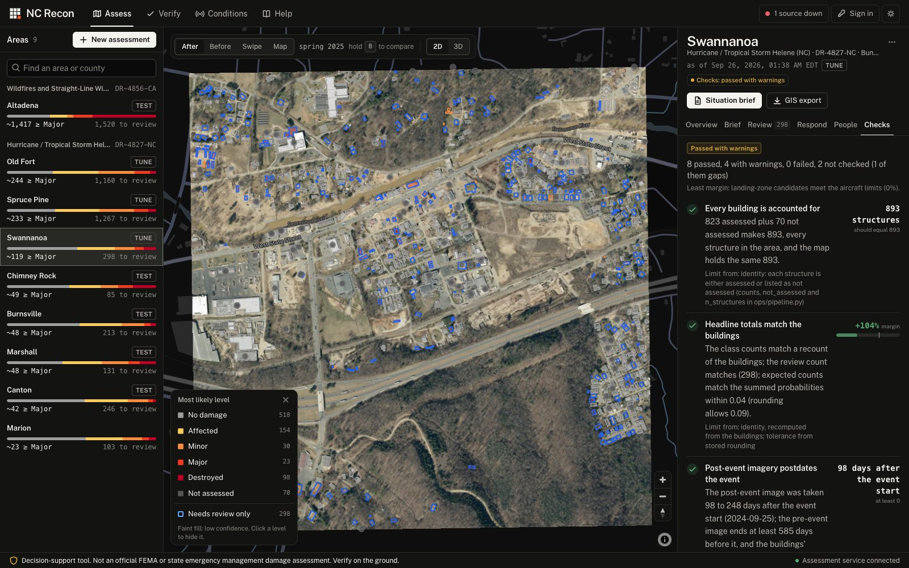
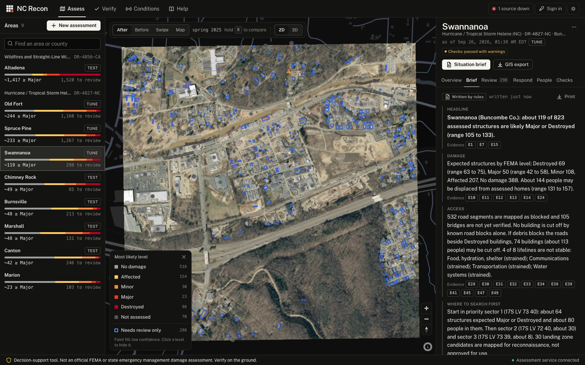
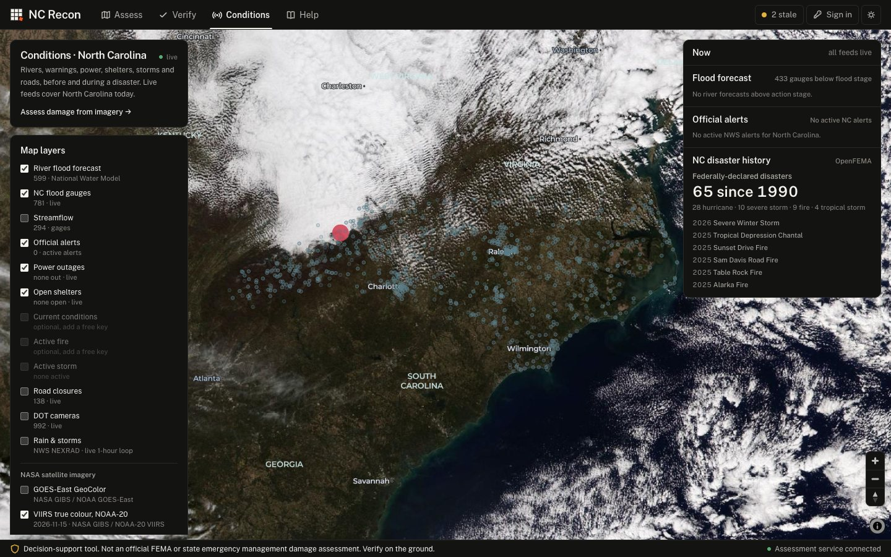

<p align="center">
  <picture>
    <source media="(prefers-color-scheme: dark)" srcset="docs/brand/logo-dark.png">
    
  </picture>
</p>

<p align="center"><b>Every building, after the disaster.</b><br>
NC Recon calls the damage to every building from public imagery, lidar and field records, checks its own work, and tells search teams where to start.</p>

<p align="center">
  <a href="https://ncrecon.netlify.app"><b>Open the live app: ncrecon.netlify.app</b></a> ·
  <a href="https://www.youtube.com/watch?v=NxaThnvTAm4"><b>▶ Watch the Congressional App Challenge video</b></a>
</p>

<p align="center">
  <a href="https://ncrecon.netlify.app"></a>
  <a href="https://www.congressionalappchallenge.us/"></a>
  <a href="https://www.youtube.com/watch?v=NxaThnvTAm4"></a>
  <a href="LICENSE"></a>
</p>
<p align="center">
  <a href="https://github.com/print-EddyMa/nc-recon/actions/workflows/ci.yml"></a>
  
  
  
  
  
  
  
  
  
  
  
  
  
</p>
<p align="center"><sub>
  Data: <a href="https://www.fema.gov/about/openfema">OpenFEMA</a> ·
  <a href="https://gis-fema.hub.arcgis.com/">FEMA USA Structures</a> ·
  <a href="https://www.hec.usace.army.mil/confluence/nsi">USACE NSI</a> ·
  <a href="https://www.nconemap.gov/">NC OneMap</a> ·
  <a href="https://storms.ngs.noaa.gov/">NOAA NGS imagery</a> ·
  <a href="https://www.usgs.gov/3d-elevation-program">USGS 3DEP</a> ·
  <a href="https://waterdata.usgs.gov/">USGS Water Data</a> ·
  <a href="https://water.noaa.gov/">NOAA NWPS</a> ·
  <a href="https://www.weather.gov/">NWS</a> ·
  <a href="https://nasa-gibs.github.io/gibs-api-docs/">NASA GIBS</a> ·
  <a href="https://www.openstreetmap.org/copyright">OpenStreetMap</a> ·
  <a href="https://www.fire.ca.gov/">CAL FIRE DINS</a> ·
  <a href="https://gocivilairpatrol.com/">Civil Air Patrol</a>
</sub></p>

<p align="center">
  
</p>
<p align="center"><sub>Swannanoa, North Carolina, after Hurricane Helene: 893 buildings read in 88 seconds on one laptop. Real terrain (USGS 3DEP) and imagery (NC OneMap).</sub></p>

<p align="center">
  <a href="https://www.youtube.com/watch?v=NxaThnvTAm4"></a><br>
  <a href="https://www.youtube.com/watch?v=NxaThnvTAm4"><b>▶ Watch on YouTube</b></a>
</p>

<table>
  <tr>
    <td width="33%"></td>
    <td width="33%"></td>
    <td width="33%"></td>
  </tr>
  <tr>
    <td><sub><b>Self-check.</b> Every assessment checks itself and shows its margin.</sub></td>
    <td><sub><b>Brief.</b> Six lines, every figure traced to evidence.</sub></td>
    <td><sub><b>Watch.</b> Live North Carolina conditions with NASA imagery.</sub></td>
  </tr>
</table>

Free during launch. Open source under the [Apache License 2.0](LICENSE).
Pilots and questions: **ma.eddy.work@gmail.com**.

> Decision support. Not an official FEMA or state emergency management damage
> assessment. Verify on the ground.

## What it does

* **Assess.** Type a FEMA disaster number. NC Recon reads the declaration, finds
  before and after imagery for any US state, finds every building, and gives
  each one of FEMA's five damage levels with a probability and the evidence
  behind it. Flood, wind, wildfire, earthquake and landslide.
* **Verify.** Uncertain and severe calls go to people, who judge them blind,
  with Civil Air Patrol photos of the building.
* **Respond.** Roads likely cut, people cut off, lifelines at risk,
  landing-zone candidates and 1 km search sectors in US National Grid, as KML
  for TAK and Google Earth.
* **Export.** FEMA's damage survey fields, GeoPackage, File Geodatabase, KML,
  CSV, a situation brief, and the state's initial damage assessment packet in
  the formats FEMA's July 2025 PDA guide accepts.
* **Share.** A private, expiring record of one building for a verified owner
  (for a FEMA appeal or an insurer), a public "is my street OK?" check that
  never shows one home, and the NC Recon Index of public counts per area.
* **Self-check.** Every assessment checks itself and shows how much room each
  check has left: every building accounted for, totals recounted a second way,
  imagery dates, image alignment, model weights, landing zones against the
  aircraft they are listed for. A failed check labels the exports; it never
  blocks them. The idea and the margin maths come from
  [Margin](https://github.com/print-EddyMa/margin).
* **Brief.** The situation in six lines, every figure tied to a numbered piece
  of evidence. Written by fixed rules by default; with an Anthropic API key on
  the server, Claude can write it from area totals only, and code drops any
  item whose numbers do not trace. The pattern comes from
  [Canary](https://github.com/print-EddyMa/Canary).
* **Watch.** Before the storm: NWS alerts, river forecasts and gauges, power,
  shelters and road closures for North Carolina, with NASA GIBS imagery
  (GOES-East every 10 minutes, VIIRS true colour, IMERG rain, SMAP soil
  moisture, OPERA surface water and Sentinel-1 radar).
* **Offline (beta).** Carry an assessed area to a field laptop with no network.

## Who it's for

| | What they get |
|---|---|
| Emergency management (counties, states, tribes) | Damage counts the day imagery arrives; the IDA packet; ranked search sectors |
| Insurers and lenders | A call per building with its evidence, from a method you can inspect and re-run |
| National Guard and responders | An offline field kit, TAK-ready KML, USNG sectors, landing-zone candidates |
| Aid groups and nonprofits | Area-level counts for targeting cash and supplies, never one home |
| Researchers and AI labs | Calls checked by people, field records to compare against, fresh test sets |
| Residents | Through a county or legal aid partner: their street, and a private record of their home |

## Results so far

* **Eaton fire, 2025 (wildfire model, held out):** of 2,246 buildings CAL FIRE
  inspected, when NC Recon called a building Major or Destroyed the inspectors
  agreed 95.7% of the time, and NC Recon found 94.2% of the ones they marked that
  way. One run, rule fixed before it ran; the wildfire model alone, not the
  whole system. Details: [`docs/model/MODEL_CARD.md`](docs/model/MODEL_CARD.md).
* **Swannanoa, Hurricane Helene:** 893 buildings in 88 seconds on one laptop.
  Flood is harder: water inside a house does not show from above, so NC Recon
  found 15 of the 64 homes county search teams recorded as Major or
  Destroyed. Flood accuracy is still being validated, and every severe call
  goes to people before it counts.

## Models

| Model | What it does | Where it is used | How well it is known |
|---|---|---|---|
| **ncrecon-dmg-v0** (NC Recon's own) | Before and after chips of each building, a frozen ResNet-18 and a logistic regression, five FEMA damage levels. Trained only on public-domain imagery (USDA NAIP, NOAA NGS) and CAL FIRE labels. | Wildfire, replacing the general model | Eaton fire, one pre-registered held-out test: precision 95.7%, recall 94.2%, 2,246 buildings. [Model card](docs/model/MODEL_CARD.md) |
| **General image model** (xView2 baseline, CMU SEI, BSD-3) | A Keras classifier exported to ONNX, read on onnxruntime. Released as a checked download (SHA-256 `711fbdd4…`). | Flood and wind (channel E1) | Trained on xBD (non-commercial terms). Flood accuracy is still being validated. [Weights](pipeline/weights/README.md) |
| **Change signal** (E2) | Pixel change inside each footprint against the whole town, on a co-registered pair. Switched off when the pair is misaligned by more than 1 pixel. | Every hazard | An independent second route the self-checks compare against. |
| **Context channels** | Blue tarps (E4), published river crests for flood depth (E5), lidar ground change (E6), hazard footprints (fire perimeters, ShakeMap, landslides). | Per hazard | Each reports when it is unavailable and why. |
| **Fusion** | Combines the channels into a probability per level with an 80% interval, and routes uncertain and severe calls to people. | Every assessment | Probabilities are not yet calibrated on ground truth; ranges are wider than shown. |
| **Claude** (optional) | Writes the area brief from area totals only; code traces every figure. | Brief, only if a key is set | Off by default; never sees addresses or single buildings. |

## Data

Everything NC Recon reads is public. The main sources:

| Kind | Sources |
|---|---|
| Disasters and events | OpenFEMA declarations and housing assistance, NWS alerts, NHC storm tracks, USGS ShakeMap, NIFC fire perimeters, NC Geological Survey landslides |
| Buildings | FEMA USA Structures (CC BY 4.0), USACE National Structure Inventory, OpenStreetMap gap-fill (ODbL) |
| Imagery | NC OneMap orthoimagery (2020 to 2023 and post-Helene 2025), NOAA NGS Emergency Response Imagery, USDA NAIP, Maxar Open Data (CC BY-NC 4.0), Civil Air Patrol photos (FEMA) |
| Elevation and water | USGS 3DEP, NC 2025 QL1 lidar, USGS Water Data and peak flows, USGS high-water marks, NOAA NWPS forecasts, NC FIMAN gauges, NCEM published crests |
| Response | OpenStreetMap lifeline facilities, FEMA hospitals, USACE dams, EPA facilities and water systems, FAA heliports, ESA WorldCover, DOE ODIN and Duke Energy outages, FEMA open shelters, Census and CDC SVI |
| Live conditions | NASA GIBS (GOES-East, VIIRS, IMERG, SMAP, OPERA), NWS NEXRAD radar, NCDOT closures and cameras, NASA FIRMS (optional key) |
| Field records for comparison | CAL FIRE damage inspections, FEMA damage assessments, Buncombe County search-team categories, UNCA NEMAC damage points |

Every source with its endpoint, licence, datum and caveats: [`docs/ops/DATA_SOURCES.md`](docs/ops/DATA_SOURCES.md). Licences and attribution: [`LICENSES.md`](LICENSES.md).

## Get started

### Try it live

**[ncrecon.netlify.app](https://ncrecon.netlify.app)** is the real app: live North Carolina conditions, "Is my street OK?", the NC Recon Index, and every assessed area's totals. Building-level views, exports and new assessments need a responder token. The launch page is at [ncrecon.netlify.app/about](https://ncrecon.netlify.app/about/). The server runs on the team's own computer ([`deploy/home/`](deploy/home/README.md)), so the live site can be offline at times.

### Run it (one container, HTTPS, both models built in)

```bash
cp .env.example .env    # set TERRATRIAGE_TOKEN, NCR_OWNER_SECRET and NCR_DOMAIN
docker compose up -d --build
```

The build downloads and checks both damage models: NC Recon's wildfire model and
its encoder, and the general image model from this repo's
[`model-general-v1`](https://github.com/print-EddyMa/nc-recon/releases/tag/model-general-v1) release.
Open `https://<NCR_DOMAIN>/` and paste the token under **Sign in**. Full guide,
security model and backups: [`docs/ops/DEPLOYMENT.md`](docs/ops/DEPLOYMENT.md).

### Develop locally

```bash
# API and worker (Python 3.13)
cd pipeline
python3 -m venv .venv
.venv/bin/pip install --index-url https://download.pytorch.org/whl/cpu torch==2.13.0 torchvision==0.28.0   # Linux; on macOS plain pip is fine
.venv/bin/pip install -r requirements-dev.txt
PYTHONPATH=src .venv/bin/python -m terratriage.ops.model.fetch_encoder   # wildfire model encoder
NCR_DEV_OPEN=1 .venv/bin/python server.py           # :8000, auth off (dev only)
.venv/bin/python -m pytest tests -q                  # offline suite

# web (Node 22)
cd web
npm install
echo "VITE_API_URL=http://127.0.0.1:8000" > .env.development.local
npm run dev                                          # :5173
```

The general image model (flood and wind) is a 474 MB download; locally, see
[`pipeline/weights/README.md`](pipeline/weights/README.md). Without it NC Recon
runs and says that channel is off.

## Documentation

* Launch checklist (ready, and what still needs a person): [`docs/LAUNCH.md`](docs/LAUNCH.md)
* Event playbook: [`docs/ops/OPERATIONS.md`](docs/ops/OPERATIONS.md)
* Deployment and configuration: [`docs/ops/DEPLOYMENT.md`](docs/ops/DEPLOYMENT.md); the live site: [`deploy/home/README.md`](deploy/home/README.md)
* Any hazard, any state: [`docs/ops/ANY_HAZARD.md`](docs/ops/ANY_HAZARD.md)
* Offline field packs: [`docs/ops/OFFLINE.md`](docs/ops/OFFLINE.md)
* Response products: [`docs/response/README.md`](docs/response/README.md)
* Verified ground truth: [`docs/truth/README.md`](docs/truth/README.md)
* Models: [`docs/model/MODEL_CARD.md`](docs/model/MODEL_CARD.md), [`MODEL_CARD.md`](MODEL_CARD.md), [`BIAS_AUDIT.md`](BIAS_AUDIT.md)
* Data sources and licences: [`docs/ops/DATA_SOURCES.md`](docs/ops/DATA_SOURCES.md), [`LICENSES.md`](LICENSES.md)
* Design system: [`DESIGN.md`](DESIGN.md)
* Website: [`site/`](site/) (`python3 site/build.py`)

## Layout

```
pipeline/
  server.py                 FastAPI: /ops API, live feeds, serves the built web app
  src/terratriage/ops/      plan, collect, process, analyze, disseminate, response, model, offline
  config/                   events, hazards, context rules, crosswalks, FEMA damage matrix
  tests/                    pytest (offline)
web/                        React app: Assess, Verify, Conditions, Help; public check, index, owner record
site/                       the public website
docs/                       operations, deployment, models, data
```

## Pricing

Free during launch: every feature, self-hosted or as a pilot we run with you.
Paid hosting and support will come later and will be announced well before
anything changes. To request a pilot: **ma.eddy.work@gmail.com**.

## Licence, data and security

Code: Apache-2.0 ([`LICENSE`](LICENSE), [`NOTICE`](NOTICE)). NC Recon reads
public data whose own terms travel with the outputs (OpenStreetMap is ODbL;
Maxar Open Data and the xView2 baseline model are non-commercial): see
[`LICENSES.md`](LICENSES.md). Report a vulnerability privately: [`SECURITY.md`](SECURITY.md).
