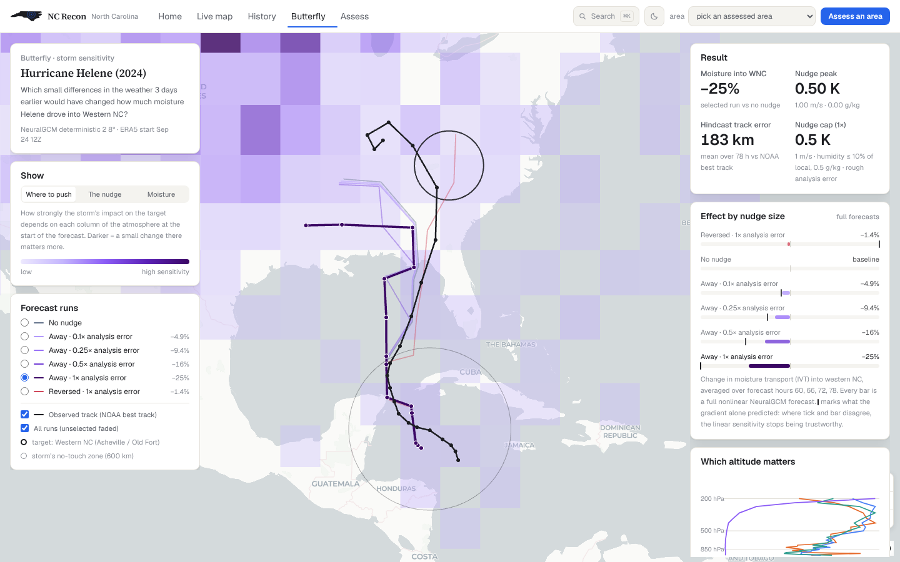

# Butterfly - storm sensitivity for NC Recon

> *Which small differences in the weather three days earlier would have changed
> what Hurricane Helene did to western North Carolina?*

NC Recon's risk monitor shows **what** is coming and the damage pipeline shows
**what happened**. Butterfly asks **why**: how sensitive an NC storm impact was
to the state of the atmosphere days before. It backpropagates through a real,
differentiable weather model (**NeuralGCM**) started from the real atmosphere
(**ERA5**), and then checks every answer with full forecasts.

That is the question operational forecasters answer when deciding where extra
observations (hurricane-hunter aircraft, dropsondes) would improve a forecast
most. It is a sensitivity diagnostic, **not a weather-control tool**.

The web screen is `#/butterfly` (**g** then **b**); it reads
`web/public/data/butterfly/<case>.json`, written by this package.

## What it does

```
ERA5 (real atmosphere, 37 levels, 0.25°)  ─ regrid ─►  NeuralGCM 2.8° encode
        │                                                     │  78 h forecast (hourly, checkpointed)
        │                                                     ▼
        │                                     J = mean over +60…78 h of moisture transport (IVT)
        │                                         into western NC (Gaussian, 220 km, Asheville/Old Fort)
        │                                                     │
        └──────────── ∂J / ∂(T, u, v, q at t0)  ◄── adjoint ──┘     (problem.py)
                              │
          steepest-descent nudge in the moist total-energy norm, troposphere only
          (1000-200 hPa), zero within 600 km of the storm, each field capped at
          s × a rough analysis error (0.5 K, 1 m/s, min(0.5 g/kg, 10 % of local q))
                              │
          full nonlinear re-forecasts for s = 0.1, 0.25, 0.5, 1 and the reversed nudge,
          each compared with the gradient's own linear prediction           (run.py steer)
                              │
          export ─► web/public/data/butterfly/helene.json                           (export_web.py)
```

- **Observable-space perturbations.** The nudge is applied to the ERA5 fields
  themselves (temperature, winds, humidity on pressure levels), so its size is
  stated in K, m/s and g/kg and compared with typical analysis uncertainty
  (~0.5 K, 1 m/s, 0.5 g/kg; rough ERA5 tropical magnitudes, not exact error bars).
- **Energy norm.** Gradients are turned into directions with the moist
  total-energy norm (Ehrendorfer et al. 1999), the norm ECMWF uses for singular
  vectors, so K, m/s and kg/kg are comparable.
- **Gradient checkpointing.** Plain reverse-mode through 78 h of NeuralGCM
  needs ~124 GB; stepping hour-by-hour under `jax.checkpoint` inside a
  `lax.scan` brings it under ~10 GB on CPU.
- **Verified, not linearised.** Every number on the web screen comes from a full
  nonlinear forecast with the nudge put back in, shown next to what the gradient
  alone predicted, so you can see where the linear sensitivity stops being true.

### A trap worth knowing (it bit the first version)

Steepest descent in an energy norm divides the gradient by each layer's air
mass, so it piles the nudge into the near-massless model top. The first run put
0.5 g/kg of water vapour at 1 hPa, about 130× the humidity actually there, and
the "nudged" forecasts swung by -90 % to +1,800 %: the model was being broken,
not steered. Operational sensitivity work restricts to the troposphere for this
reason; so does this code now (`TROPOSPHERE_TOP_HPA`), with humidity capped
relative to its local value. A second, subtler trap: scaling all fields by one
shared factor let the tight upper-level humidity cap throttle temperature and
wind to ~10⁻⁴; each field is now scaled to its own cap.

## Results - Hurricane Helene, western NC

ERA5 start 24 Sep 2024 12Z (Helene a 40-kt tropical storm in the NW Caribbean),
NeuralGCM 2.8°, objective = mean IVT into western NC over +60…78 h
(baseline 783 kg m⁻¹ s⁻¹). Every row is a full nonlinear re-forecast;
"predicted" is what the gradient alone said.

| nudge (each field ≤ s × analysis error) | real change | gradient predicted | delivered |
|---|---|---|---|
| away, 0.1× (≤0.05 K, ≤0.1 m/s) | **−4.9 %** | −5.5 % | 89 % |
| away, 0.25× | **−9.4 %** | −13.8 % | 68 % |
| away, 0.5× | **−15.6 %** | −27.6 % | 57 % |
| away, 1× (≤0.5 K, ≤1 m/s) | **−25.5 %** | −55.2 % | 46 % |
| reversed, 1× | **−1.4 %** | +55.2 % | wrong sign |

- The response is monotonic in nudge size and the gradient is close to honest
  for small nudges, then **over-promises more and more** as the nudge grows,
  the same pattern the toy model showed.
- The reversed nudge pulled the model storm much closer to NC (113 km at +72 h
  vs 447 km) yet did **not** raise the moisture there: a strongly nonlinear,
  asymmetric response.
- The nudge's energy peaks upstream over the central US (~43°N, 98°W), where the
  trough that pulled Helene north came from. Humidity contributes almost nothing
  (its 10 %-of-local cap binds); temperature and wind carry the effect.
- Hindcast skill: mean track error 183 km over 78 h vs NOAA's best track, but
  the model's Helene runs slow, 362-486 km behind by +72-78 h.

### How sure are we? (`python -m butterfly.run suite|cnop|transfer`)

| check | method | result |
|---|---|---|
| Is the gradient right? | Taylor test: real ÷ predicted change as the nudge shrinks | 0.988 (0.02×) · 0.949 (0.05×) · 0.886 (0.1×) · 0.685 · 0.566 · 0.462 (1×): converges to 1, so the adjoint is correct and the fall-off is real nonlinearity |
| Is the direction special? | Monte-Carlo null: 5 smooth random nudges under the same per-field caps (~100× the adjoint nudge's energy) | random: −1.9 % … +0.8 %; adjoint: **−25.5 %** |
| Why did the track move? | deep-layer-mean (850-200 hPa) steering flow in a 200-800 km ring around the model storm, +36-66 h | un-nudged (2.8 E, 9.2 N) m/s; away nudge (−0.9, −0.4) m/s ≈ 130 km slower/westward; reversed nudge +0.9 m/s eastward, toward NC |
| Can a better nudge be found? | CNOP (Mu et al. 2003): re-linearise at the nudged state, projected step back onto the caps | one extra adjoint: **−33.2 %** vs −25.5 % for the one-step nudge |
| Is it reproducible? | re-run the same forecasts | identical J to 3 decimals (deterministic model, fixed key) |
| Does it transfer to another model? | interpolate the nudge into NeuralGCM 1.4° (finer, separately trained; same family) | **−7.0 %** (910 → 846) vs −25.5 % at 2.8°: same direction, ~¼ the size. Part of the sensitivity is model-specific |
| Which model should the adjoint use? | un-nudged track error vs NOAA best track | 2.8°: mean 183 km, 362 km at +72 h. **1.4°: mean 77 km, 22 km at +72 h**. The 1.4° adjoint (~4-5× the compute; a GPU job) is the clear next step |



### Rainfall itself (`--case helene-rain`)

NeuralGCM's precipitation-trained model (`stochastic_precip_2_8_deg`, fixed
random key) gives rain directly, so the objective becomes the rain that fell
over western NC between +24 and +78 h (25 Sep 12Z - 27 Sep 18Z). Accumulated
precipitation lives in the model state, so hourly (checkpointed) and 6-hourly
stepping agree to 1 part in 10⁶.

| | rain over WNC | vs no nudge | gradient predicted |
|---|---|---|---|
| no nudge | 70.4 mm (ERA5: 138 mm; wettest ERA5 cell 394 mm; gauges recorded more) | | |
| away 0.1× / 0.5× / 1× | | −5.7 / −15.7 / **−34.8 %** | −9.1 / −44.4 / −88.8 % |
| reversed 1× | | **+39.0 %** | +88.8 % |
| 3 random nudges | | +0.8 … +3.3 % | |

Rain responds more, and in both directions, than moisture transport, but it is
also more nonlinear (0.1× delivers 64 % of the prediction vs 89 %). The model
under-rains (half of ERA5) and its storm stays far from WNC: a 2.8° limitation.

### Where should extra observations go? (`python -m butterfly.run osse`)

A simulated targeted-observation experiment. Truth = ERA5; analysis = truth +
smooth tropospheric errors (RMS 0.5 K, 1 m/s, 10 % of humidity); "observing" a
700 km disk removes 70 % of the error there. Analysis error spreads the WNC
moisture forecast by ±9.9 %.

| strategy | error-variance reduction (linear, 2,000 samples, held-out) |
|---|---|
| observe the storm (routine reconnaissance) | 26 % |
| best single spot (adjoint) | 26 % (it is the storm) |
| random spot | 0.4 % median |
| storm + adjoint-chosen 2nd spot (40.5°N 95.6°W) | **48 %** |
| storm + random 2nd spot | 26 % median; none of 400 better than the adjoint's |

Checked with 3 sets of full forecasts (RMS error of the impact): no extra obs
9.6 %, storm 8.5 % (confirms the linear estimate), storm + adjoint 2nd 9.7 %
(**not confirmed**), storm + random 2nd 7.9 %. The model storm switches between
two track branches ~200 km apart; a tipped branch dominates the error, and a
linear estimate cannot see that. Three samples cannot settle the second-spot
question; the storm-centred result holds.

## Run it

```bash
cd pipeline
python -m venv .venv-butterfly && ./.venv-butterfly/bin/pip install -r butterfly/requirements.txt
mkdir -p butterfly/work/models
gsutil cp gs://neuralgcm/models/v1/deterministic_2_8_deg.pkl butterfly/work/models/

./.venv-butterfly/bin/python -m butterfly.run forecast --case helene   # hindcast only (~10 min CPU)
./.venv-butterfly/bin/python -m butterfly.run all --case helene        # adjoint + 5 forecasts + export
```

ERA5 is read anonymously from Google's public ARCO-ERA5 bucket (~1 GB per
start time, cached in `work/era5/`); the NOAA IBTrACS best track is downloaded
and cached on first use. CPU timings (4 cores): one 78-h forecast ≈ 8-10 min,
the adjoint ≈ 30-60 min.

Cases live in `cases.py`: `helene` (the NC case shown in the app) and `milton`
(an out-of-state validation case: wind energy over Tampa Bay).

### Safety note on checkpoints

NeuralGCM checkpoints are Python pickles. `safe_load.py` loads them with a
whitelist unpickler that only allows numpy's array reconstructor, `ndarray`
and `dtype` (what a static `pickletools` scan of the published files shows they
contain) and raises on anything else, instead of a bare `pickle.load`.

### Version pins that matter

`neuralgcm` 1.2.2 works with `jax` 0.6.x on CPU. `encode()` / `advance()` /
`decode()` take forcings **without** a time axis (they add their own);
`unroll()` takes them **with** one.

## The toy model ("lie detector")

`toy/` is where the method was developed: a 2-D β-plane vortex "atmosphere"
where the exact adjoint is available, so an AI emulator's gradients can be
graded against the truth. Findings (8 unseen storms; figures in `docs/butterfly/`):

- optimised nudges at 0.1-1 % of the storm's energy move it 6-8× further than
  random nudges of the same energy;
- searching through the AI emulator recovers ~75-100 % of what the exact adjoint
  finds, but **systematically over-promises** by 5-10 points;
- a good forecast does not guarantee a good gradient: on one storm the
  emulator tracked well, yet its sensitivity map had cosine similarity −0.03
  with the truth.

```bash
cd pipeline/butterfly/toy
python data.py && python emulator.py && python experiments.py && python hero.py && python render.py
```

## Limits (read before quoting a number)

- **2.8° (~300 km) model.** Track and large-scale moisture are meaningful;
  the storm's core and intensity are not resolved.
- **Same-model check.** Nudges are verified by the model that designed them.
  The independent check is a physics model (WRF), not yet run.
- **One NC storm** is a case study, not a statistic.
- Nudges are idealised changes to the initial state; nothing here says any
  real-world intervention could produce them.
